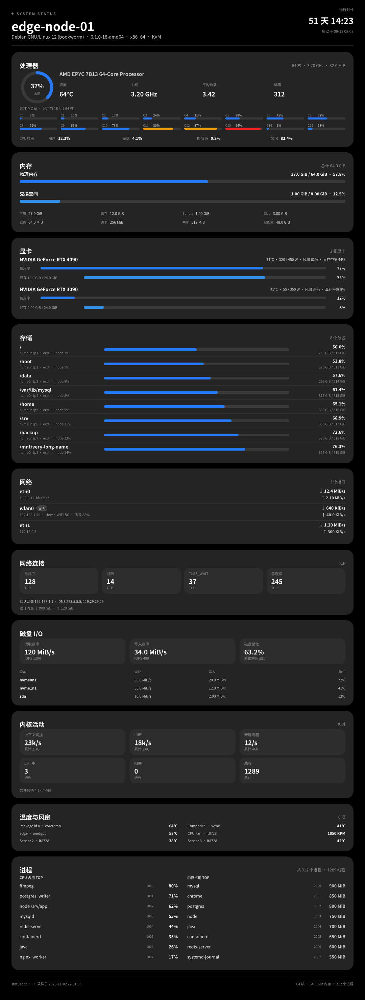

# statusbot

通过 OneBot v11 协议，在 QQ 里用一条命令获取本机状态图。

- 正向 / 反向 WebSocket，可同时配置多条连接，每条连接独立 token
- 消息文本与命令**完全一致**才触发（不多不少，含空格也必须一致）
- 后台定频采样，渲染只读快照；并发闸门 + 缓存，1C1G 也能稳定出图
- 思源黑体（Source Han Sans SC）随程序打包，不依赖系统字体
- 单图包含：CPU 总占用 / 每核 / 主频 / 温度 / 用户态 / 系统态 / IO 等待、内存明细、Swap、GPU、
  分区与 inode、网络与 WiFi、TCP 连接、每块磁盘 IO、内核活动、温度与风扇、进程 TOP、开机时长等



## 快速开始

要求 Linux（读取 /proc 与 /sys）与 Go 1.19+。

```bash
go build -trimpath -ldflags "-s -w" -o statusbot .
./statusbot            # 首次运行会在同目录生成 config.yml 后退出
vim config.yml
./statusbot
```

只想先看看效果，不连 OneBot：

```bash
./statusbot -render preview.png
```

## 配置

程序默认读取**可执行文件同目录**的 `config.yml`；若不存在，再尝试当前目录。
也可用 `-config /path/to/config.yml` 指定。

```yaml
render:
  width: 1080          # 720-2160，内部按 1080 排版后高质量缩放
  concurrency: 1       # 同时渲染数量，1C1G 建议 1
  queue: 64            # 排队上限，超过后回复“请稍后再试”
  cache_seconds: 3     # 缓存窗口，短时间大量请求合并为一次渲染
  cooldown: 2          # 单用户触发间隔（秒），0 为不限制
  top_processes: 10    # 进程榜条数
  max_disks: 6         # 最多分区数
  max_interfaces: 3    # 最多网卡数

commands:              # 绝对匹配
  - "状态"
  - "查状态"

users: []              # 空 = 所有人可用；也可写 [123456, "987654"]
# users:
#   - 123456789

connections:
  - type: forward
    name: "主连接"
    url: "ws://127.0.0.1:3001"
    token: ""
    enabled: true

  - type: reverse
    name: "反向连接"
    port: 8080
    path: "/onebot/v11/ws"
    token: "另一个token"
    enabled: true
```

### 连接说明

| 字段 | forward | reverse |
| --- | --- | --- |
| `url` | 必填，`ws://` 或 `wss://` | — |
| `port` | — | 必填，监听端口 |
| `path` | — | 默认 `/`，需以 `/` 开头 |
| `token` | 以 `Authorization: Bearer` 与 `access_token` 查询参数发送 | 校验 `Authorization: Bearer`、`X-Access-Token` 或 `access_token` |
| `enabled` | 默认 true | 默认 true |

- 可以写任意多条 forward / reverse。
- 同一个 `port` 可以配置多个不同 `path` 的反向路由，各自使用不同 token。
- 反向端口会同时提供 `/healthz` 健康检查（若路由占用了该路径则跳过）。
- 改了连接或 `concurrency` 需要重启；发送 `SIGHUP` 可热加载命令、白名单与其他渲染参数。

### 触发规则

- 只处理 `message` 事件中的群聊 / 私聊消息。
- 消息必须**全部由文本段组成**，拼接后与某条命令完全相等；带 @、图片、表情、回复等
  任意非文本段都不会触发。
- `users` 为空表示所有人可用，否则只响应列表中的 QQ 号。
- 同一 `message_id` 在 20 秒内只回复一次（防止多连接重复投递）。
- 默认同一用户 2 秒内只出一次图，可用 `cooldown: 0` 关闭。
- 回复格式：`{"type":"image","data":{"file":"base64://..."}}`，需要 OneBot 实现支持
  base64 图片（go-cqhttp、NapCat、LLOneBot 等均支持）。

## 性能设计

- 后台每 1 秒采样 /proc 与 /sys（GPU 约 2 秒），生成不可变快照；渲染路径不扫描系统。
- 图片按 `cache_seconds` 缓存；突发请求共享同一张图。
- 渲染并发由 `concurrency` 控制，等待队列有上限，超出直接回复繁忙，避免 1C1G 被打爆。
- 单张 1080 宽图片约 200-400 ms CPU（老款 2 核 VPS 实测约 250 ms），临时内存约 10-15 MB。
- 内部固定按 1080 宽排版后缩放，建议宽度 1080-1440；更大的宽度只是放大，不会更清晰。
- 字体常驻内存约 35 MB，这是本项目最大的一笔固定开销。

## 部署

```bash
sudo mkdir -p /opt/statusbot
sudo cp statusbot config.yml /opt/statusbot/
sudo chmod 600 /opt/statusbot/config.yml
sudo cp statusbot.service /etc/systemd/system/
sudo systemctl enable --now statusbot
journalctl -u statusbot -f
```

## 常见问题

**反向连接 401**：token 不一致。OneBot 端需在 header 加 `Authorization: Bearer <token>`，
或连接地址带 `?access_token=<token>`。

**发了命令没反应**：确认消息是纯文本且与命令完全一致（空格、标点都算）；确认 QQ 号在
`users` 中（或 `users` 为空）；查看程序日志是否有“已响应”。

**没有 GPU / 温度**：无显卡时不显示显卡卡片；虚拟机通常没有温度传感器，显示 `—`。

**图片发送失败**：确认 OneBot 实现支持 `base64://`；部分实现需要开启相应配置。

**端口被占用**：反向连接会打印监听失败日志，换端口或先释放占用。

## 字体

`internal/render/fonts/` 内置思源黑体 SC Regular / Bold，遵循 SIL Open Font License 1.1，
许可证随程序一并分发（`LICENSE.txt`）。程序不会读取系统字体。

## 目录

```
main.go                 启动、配置热加载、信号处理
bot.go                  命令匹配、白名单、冷却、发送图片
internal/config/        YAML 配置与校验
internal/onebot/        OneBot v11 正/反向 WS
internal/sysinfo/       /proc 与 /sys 采样
internal/render/        排版、绘制、字体、并发缓存
```
